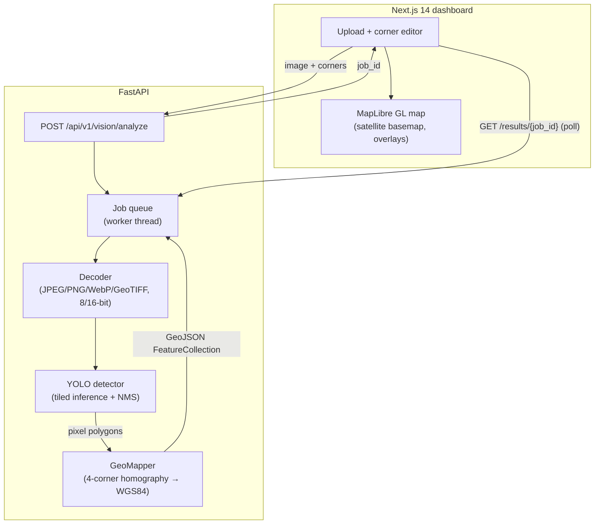

# GeoPulse AI

> **Detect objects in aerial, satellite and drone imagery and see them on a live map as geo-referenced GeoJSON.**


Upload an image, tell GeoPulse where it sits on Earth, and it will find planes, ships, vehicles, storage
tanks, swimming pools, sports courts and more. Every detection comes back as a GPS polygon drawn on a
satellite basemap, with its class, confidence and real-world area, ready to download as GeoJSON.

---

## Features

- **Aerial-first detection.** Ships with YOLOv8-OBB trained on [DOTA](https://captain-whu.github.io/DOTA/),
  an aerial-imagery dataset. Detections are *oriented* boxes that follow each object's rotation. Any
  Ultralytics detection or OBB model (YOLOv8/YOLO11, COCO or custom-trained) can be swapped in with one
  setting.
- **Sliced inference for large frames.** High-resolution images are cut into overlapping tiles, detected
  tile by tile, and merged with class-aware NMS, so small objects don't disappear when the frame is downscaled.
- **Geo-referencing.** `GeoMapper` solves a projective transform from the image's four corner coordinates.
  That handles north-up images, rotated frames and slightly oblique shots, and projects each detection to WGS84.
- **Three ways to geo-reference:**
  1. **Use map view.** Pan and zoom the map to the image's area and click one button. Rotation and pitch are respected.
  2. **GeoTIFF.** Corners are read automatically from EPSG:4326 or EPSG:3857 GeoTIFFs.
  3. **Manual entry.** Type four corner coordinates.
- **Interactive map.** MapLibre GL with Esri World Imagery and OpenStreetMap basemaps, so **no API token is
  needed**. You get an adjustable image overlay for checking alignment, per-class colours and toggles,
  click-to-inspect popups, 3D pitch and rotation.
- **Asynchronous jobs.** Uploads return a job id right away. A background worker runs inference and the UI
  polls for queue position, progress and errors, and keeps a history of recent analyses.
- **Useful metrics:** object area (m²), ground sample distance (cm/px), area covered and processing time.

---

## Architecture



```
backend/
  app/
    main.py               FastAPI app factory, CORS, health
    config.py             Settings from environment / backend/.env
    routers/vision.py     REST endpoints
    services/
      detector.py         Ultralytics YOLO wrapper (lazy load, OBB + boxes, tiling)
      tiling.py           Tile generation and NMS
      geo_mapper.py       Pixel ↔ WGS84 projection, areas, GSD
      imaging.py          Image decoding, GeoTIFF geo-reference reader
      vision_engine.py    Pipeline: decode → detect → project → GeoJSON
      jobs.py             Thread-safe job queue with eviction
  tests/                  pytest suite (runs without a GPU or model download)
frontend/
  src/app/page.tsx        Dashboard
  src/components/         MapView, CornerEditor, ResultsPanel, ImageInput, JobHistory, BackendStatus
  src/lib/                API client, types, geo helpers
```

---

## Quick start

### Option A: Docker

```bash
docker compose up --build
```

Open http://localhost:3000. The backend downloads the model (~6 MB) on first start; the API docs are at
http://localhost:8000/docs.

### Option B: Run locally

**Backend** (Python 3.10–3.13):

```bash
cd backend
python3 -m venv .venv && source .venv/bin/activate      # Windows: .venv\Scripts\activate
# Optional but recommended on machines without an NVIDIA GPU (much smaller download):
pip install torch torchvision --index-url https://download.pytorch.org/whl/cpu
pip install -r requirements.txt
cp .env.example .env                                     # optional, all settings have defaults
uvicorn app.main:app --reload --port 8000
```

**Frontend** (Node 18.17+):

```bash
cd frontend
npm install
cp .env.example .env.local                               # optional, defaults to http://localhost:8000
npm run dev
```

Open http://localhost:3000.

### Using it

1. **Drop an image** into the left panel. Top-down imagery works best: drone orthophotos or satellite
   crops at roughly 0.1–1 m per pixel.
2. **Geo-reference it.** GeoTIFFs fill this in automatically. Otherwise, navigate the map to the area the
   image covers, frame it so the view matches the image, and click **Use map view**. Turn on the image
   overlay to check alignment, and fine-tune the coordinates if needed.
3. Click **Run analysis**. Detections appear on the map. Click any of them for details, toggle classes on
   and off, and use **Download GeoJSON** to export.

Need test imagery? Screenshot or export a top-down view of an airport, port or car park from any
satellite map, or use the public DOTA or xView sample images.

---

## Configuration

All backend settings are environment variables. You can also put them in `backend/.env`; see
[`backend/.env.example`](backend/.env.example).

| Variable | Default | Description |
| --- | --- | --- |
| `GEOPULSE_MODEL` | `yolov8n-obb.pt` | Ultralytics weights. Bare names are stored in `backend/models/` and downloaded on first use. Try `yolov8s-obb.pt` or `yolov8m-obb.pt` for better accuracy, `yolov8n.pt` for COCO classes, or a path to your own `.pt`. |
| `GEOPULSE_DEVICE` | auto | `cpu`, `0` (CUDA GPU 0), `mps` (Apple Silicon) |
| `GEOPULSE_CONFIDENCE` | `0.25` | Default confidence threshold (the UI can override it per request) |
| `GEOPULSE_IOU` | `0.45` | NMS IoU threshold |
| `GEOPULSE_TILE_SIZE` | `1024` | Tile size for sliced inference on large frames |
| `GEOPULSE_TILE_OVERLAP` | `0.2` | Overlap between tiles |
| `GEOPULSE_MAX_UPLOAD_MB` | `100` | Upload size limit |
| `GEOPULSE_MAX_JOBS` / `GEOPULSE_JOB_TTL_SECONDS` | `200` / `21600` | Job retention (in memory) |
| `GEOPULSE_WARMUP` | `false` | Load the model at startup instead of on the first request |
| `GEOPULSE_CORS_ORIGINS` | `http://localhost:3000,...` | Comma-separated allowed browser origins |

Frontend: `NEXT_PUBLIC_API_URL` (default `http://localhost:8000`).

---

## API

| Method | Path | Description |
| --- | --- | --- |
| `POST` | `/api/v1/vision/analyze` | Multipart: `file`, plus one of `corners` (JSON `[[lat,lng]×4]`, ordered TL, TR, BR, BL) or `top_left_gps` + `bottom_right_gps` (JSON `[lat,lng]`); for GeoTIFFs both can be omitted. Optional `confidence`, `classes` (comma-separated). Returns `202 {job_id}`. |
| `GET` | `/api/v1/vision/results/{job_id}` | `{status: PENDING \| PROCESSING \| COMPLETED \| FAILED, data?, error?, queue_position?}` |
| `GET` | `/api/v1/vision/jobs` | Recent jobs (without result payloads) |
| `DELETE` | `/api/v1/vision/results/{job_id}` | Remove a finished job |
| `POST` | `/api/v1/vision/georef` | Read corner coordinates from a GeoTIFF |
| `GET` | `/api/v1/vision/model` | Model info and class list |
| `GET` | `/health` | Service and model status |

Example:

```bash
curl -F file=@frame.jpg \
     -F 'corners=[[25.2048,55.2708],[25.2048,55.2796],[25.1972,55.2796],[25.1972,55.2708]]' \
     http://localhost:8000/api/v1/vision/analyze
# {"job_id":"…","status":"PENDING"}
curl http://localhost:8000/api/v1/vision/results/<job_id>
```

Each feature in the result looks like this:

```json
{
  "type": "Feature",
  "geometry": { "type": "Polygon", "coordinates": [[[55.27, 25.20], "..."]] },
  "properties": {
    "class_name": "small vehicle", "confidence": 0.87, "center_lat": 25.2011, "center_lng": 55.2744,
    "area_m2": 9.4, "pixel_bbox": [412.0, 230.5, 431.2, 241.0], "oriented": true
  }
}
```

---

## Tests

```bash
cd backend
pip install -r requirements-dev.txt
pytest -q
```

The suite covers projection accuracy (including rotated frames), tiling and NMS, image decoding,
GeoTIFF parsing, the pipeline, the job queue and the HTTP API. It uses a fake detector, so it runs in
seconds without downloading a model. CI runs it on every push, along with the frontend type-check and
build.

## Limitations

- Jobs are stored in memory and are lost when the server restarts.
- Geo-referencing assumes the four corners describe a plane. Very oblique photos of hilly terrain need proper
  orthorectification first.
- GeoTIFFs in other projected CRSs (e.g. UTM) must be reprojected first:
  `gdalwarp -t_srs EPSG:4326 in.tif out.tif`.
- The browser can't preview TIFFs, so the map overlay only works for JPEG, PNG and WebP. Detection works for all formats.

## License

MIT. See [LICENSE](LICENSE).
