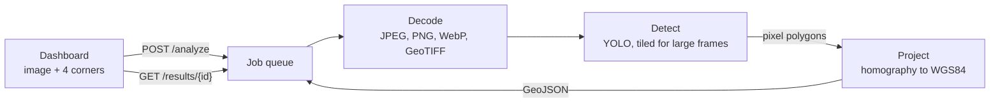

<div align="center">

# GeoPulse

**Find objects in aerial and satellite imagery and see exactly where they are on the map.**

[](https://github.com/valentinakiyungi/GeoPulse/actions/workflows/ci.yml)
[](LICENSE)


[Overview](#overview) ·
[Features](#features) ·
[Getting started](#getting-started) ·
[Usage](#usage) ·
[Configuration](#configuration) ·
[API reference](#api-reference) ·
[Development](#development) ·
[License](#license)

</div>

---

## Overview

GeoPulse turns an ordinary aerial photograph into geographic data. You upload a drone or satellite
image and mark where it sits on Earth. GeoPulse then detects the objects in it, such as vehicles,
aircraft, ships, storage tanks, swimming pools and sports courts. Each detection comes back as a
GPS polygon on an interactive map, with its class, confidence score and real-world area. You can
export everything as standard GeoJSON for use in QGIS, ArcGIS, Mapbox, Kepler.gl or your own code.

It has two parts:

| Component | Technology | Role |
| --- | --- | --- |
| **Engine** (`backend/`) | Python, FastAPI, Ultralytics YOLO, OpenCV | Decodes imagery, runs detection, projects pixels to WGS84 coordinates and serves results through a REST API |
| **Dashboard** (`frontend/`) | Next.js 14, TypeScript, Tailwind CSS, MapLibre GL | Uploads images, sets their location, runs analyses and explores results on a satellite map; works on desktop and mobile |

## Features

**Detection**
- Uses YOLOv8 with oriented bounding boxes, trained on the [DOTA](https://captain-whu.github.io/DOTA/)
  aerial-imagery dataset. The boxes follow each object's real orientation.
- Any Ultralytics model works: YOLOv8 or YOLO11, detection or oriented boxes, COCO or custom-trained. Change it with one setting.
- Large frames are analysed in overlapping tiles and the results merged, so small objects in
  high-resolution imagery are not lost.

**Geo-referencing**
- Four-corner projective transform. Handles north-up, rotated and moderately oblique images.
- Three ways to place an image:
  - line it up inside a frame drawn on the live map
  - read the location automatically from a GeoTIFF (EPSG:4326 or EPSG:3857)
  - type the corner coordinates
- Reports each object's area in m², the image's ground resolution and its total coverage.

**Dashboard**
- Satellite and street basemaps with no API key or account required.
- Overlays your image on the map so you can check alignment.
- Colour-coded classes you can toggle on and off, details for each object, and GeoJSON export.
- Responsive layout: a sidebar on desktop and a draggable bottom sheet on phones and tablets.
- Accessible: keyboard navigation, visible focus states and reduced-motion support.

**Operations**
- Analyses run as asynchronous jobs, with queue position and clear error reporting.
- Configured entirely through environment variables. Ships with Docker images, Docker Compose and a CI workflow.

## How it works



1. The dashboard uploads the image with the GPS coordinates of its four corners. The engine returns a job ID immediately.
2. A background worker decodes the image and normalises 16-bit, greyscale and multi-band data to standard RGB.
3. YOLO detects objects. Images larger than the tile size are split into overlapping tiles, and
   duplicate detections are merged with class-aware non-maximum suppression.
4. `GeoMapper` solves the projective transform between the image's pixel corners and their GPS
   coordinates, then converts every detection polygon to longitude and latitude.
5. The dashboard polls for the result and draws it on the map.

## Getting started

### Prerequisites

| Requirement | Version | Notes |
| --- | --- | --- |
| Python | 3.10 – 3.13 | For the engine |
| Node.js | 18.17 or later | For the dashboard |
| Git | any | |
| Docker | optional | For the one-command setup |

The engine runs on a CPU. An NVIDIA GPU (CUDA) or Apple Silicon (MPS) speeds up large images considerably.

### Option 1: Docker Compose

```bash
git clone https://github.com/valentinakiyungi/GeoPulse.git
cd GeoPulse
docker compose up --build
```

| Service | URL |
| --- | --- |
| Dashboard | http://localhost:3000 |
| API | http://localhost:8000 |
| Interactive API docs | http://localhost:8000/docs |

The detection model (about 6 MB) downloads automatically on first start and is cached in a Docker volume.

### Option 2: Run locally

**1. Engine**

```bash
cd backend
python -m venv .venv
source .venv/bin/activate          # Windows PowerShell: .venv\Scripts\Activate.ps1

# Recommended on machines without an NVIDIA GPU: a much smaller CPU-only PyTorch
pip install torch torchvision --index-url https://download.pytorch.org/whl/cpu

pip install -r requirements.txt
cp .env.example .env               # optional; every setting has a default
uvicorn app.main:app --reload --port 8000
```

**2. Dashboard** (in a second terminal)

```bash
cd frontend
npm install
cp .env.example .env.local         # optional; defaults to http://localhost:8000
npm run dev
```

Open http://localhost:3000.

## Usage

1. **Choose an image.** Straight-down imagery between about 10 cm and 1 m per pixel works best, such as drone orthophotos or satellite crops.
2. **Set its location.** For a GeoTIFF this happens automatically. For other images an orange
   frame with the image's proportions appears on the map. Move and zoom the map until the area
   the image shows fills the frame, then select **Set area**. Turn on **Show my image** to check
   the alignment. You can also enter the corner coordinates yourself under **Edit coordinates**.
3. **Run the analysis.** Adjust **Minimum confidence** if needed and select **Run analysis**.
4. **Explore the results.** Select any object on the map or in the list to see its details. Toggle
   classes on and off, and select **GeoJSON** to download the results.

To try it without your own data, take a straight-down screenshot of an airport apron, port or
car park from any satellite map and frame the same area. You can also use sample images from the
public DOTA or xView datasets.

## Configuration

### Engine

Set these as environment variables or in `backend/.env`. See [`backend/.env.example`](backend/.env.example).

| Variable | Default | Description |
| --- | --- | --- |
| `GEOPULSE_MODEL` | `yolov8n-obb.pt` | Model weights. Bare names are stored in `backend/models/` and downloaded on first use. Use `yolov8s-obb.pt` or `yolov8m-obb.pt` for higher accuracy, `yolov8n.pt` for the 80 COCO classes, or a path to your own `.pt` file. |
| `GEOPULSE_DEVICE` | automatic | `cpu`, `0` for the first CUDA GPU, or `mps` for Apple Silicon |
| `GEOPULSE_CONFIDENCE` | `0.25` | Default minimum confidence; the dashboard can override it per analysis |
| `GEOPULSE_IOU` | `0.45` | Overlap threshold for merging duplicate detections |
| `GEOPULSE_TILE_SIZE` | `1024` | Tile size in pixels for large images |
| `GEOPULSE_TILE_OVERLAP` | `0.2` | Fraction of overlap between neighbouring tiles |
| `GEOPULSE_MAX_UPLOAD_MB` | `100` | Maximum upload size |
| `GEOPULSE_MAX_JOBS` | `200` | Maximum number of jobs kept in memory |
| `GEOPULSE_JOB_TTL_SECONDS` | `21600` | How long finished jobs are kept |
| `GEOPULSE_WARMUP` | `false` | Load the model at startup instead of on the first analysis |
| `GEOPULSE_CORS_ORIGINS` | `http://localhost:3000,http://127.0.0.1:3000` | Comma-separated browser origins allowed to call the API |

### Dashboard

| Variable | Default | Description |
| --- | --- | --- |
| `NEXT_PUBLIC_API_URL` | `http://localhost:8000` | Engine URL as reachable from the user's browser. It is built into the bundle, so rebuild after changing it. |

## API reference

Base path: `/api/v1/vision`. Interactive documentation is served at `/docs` (Swagger UI) and `/redoc`.

| Method | Endpoint | Description |
| --- | --- | --- |
| `POST` | `/analyze` | Queue an image for analysis. Returns `202` with a `job_id`. |
| `GET` | `/results/{job_id}` | Job status and, when complete, the GeoJSON result |
| `DELETE` | `/results/{job_id}` | Remove a finished job |
| `GET` | `/jobs` | Recent jobs, without result payloads |
| `POST` | `/georef` | Read corner coordinates from a GeoTIFF |
| `GET` | `/model` | Loaded model, classes and inference settings |
| `GET` | `/health` | Service and model status (at the root, not under the base path) |

**`POST /analyze`** takes `multipart/form-data`:

| Field | Required | Description |
| --- | --- | --- |
| `file` | yes | The image (JPEG, PNG, WebP, BMP or TIFF/GeoTIFF) |
| `corners` | one geo-reference option | JSON array of four `[lat, lng]` pairs: top left, top right, bottom right, bottom left |
| `top_left_gps`, `bottom_right_gps` | one geo-reference option | JSON `[lat, lng]` each; for north-up images |
| `confidence` | no | Minimum confidence, 0.01–0.99 |
| `classes` | no | Comma-separated class names to keep |

For GeoTIFFs carrying EPSG:4326 or EPSG:3857 geo-referencing, the corner fields can be omitted.

**Job status values:** `PENDING` (includes `queue_position`), `PROCESSING`, `COMPLETED` (includes `data`) and `FAILED` (includes `error`).

**Example**

```bash
curl -F file=@frame.jpg \
     -F 'corners=[[25.2048,55.2708],[25.2048,55.2796],[25.1972,55.2796],[25.1972,55.2708]]' \
     http://localhost:8000/api/v1/vision/analyze
# {"job_id":"3f1c…","status":"PENDING"}

curl http://localhost:8000/api/v1/vision/results/3f1c…
```

A completed result is a GeoJSON `FeatureCollection` with an extra `metadata` object:

```json
{
  "type": "FeatureCollection",
  "features": [
    {
      "type": "Feature",
      "geometry": { "type": "Polygon", "coordinates": [[[55.27441, 25.20112], "…"]] },
      "properties": {
        "class_name": "small vehicle",
        "confidence": 0.87,
        "center_lat": 25.2011,
        "center_lng": 55.2744,
        "area_m2": 9.4,
        "pixel_bbox": [412.0, 230.5, 431.2, 241.0],
        "oriented": true
      }
    }
  ],
  "metadata": {
    "total_detections": 1,
    "class_counts": { "small vehicle": 1 },
    "ground_sample_distance_m": 0.31,
    "footprint_area_m2": 744120.5,
    "processing_seconds": 1.42
  }
}
```

## Project structure

```
GeoPulse/
├── backend/
│   ├── app/
│   │   ├── main.py              Application factory, CORS, health check
│   │   ├── config.py            Settings from environment variables
│   │   ├── routers/vision.py    REST endpoints
│   │   └── services/
│   │       ├── detector.py      YOLO wrapper: lazy loading, oriented boxes, tiling
│   │       ├── tiling.py        Tile layout and non-maximum suppression
│   │       ├── geo_mapper.py    Pixel ↔ WGS84 projection, areas, ground resolution
│   │       ├── imaging.py       Image decoding and GeoTIFF reading
│   │       ├── vision_engine.py Decode → detect → project → GeoJSON
│   │       └── jobs.py          Thread-safe background job queue
│   ├── tests/                   pytest suite
│   ├── Dockerfile
│   └── requirements*.txt
├── frontend/
│   ├── src/app/                 Page, layout, global styles
│   ├── src/components/          Map, survey frame, panels
│   ├── src/lib/                 API client, types, geo helpers
│   └── Dockerfile
├── .github/workflows/ci.yml
└── docker-compose.yml
```

## Development

**Tests**

```bash
cd backend
pip install -r requirements-dev.txt
pytest -q
```

The suite covers projection accuracy (including rotated frames), tiling and merging, image
decoding, GeoTIFF parsing, the processing pipeline, the job queue and the HTTP API. It uses
stand-in detectors, so it runs in seconds without a GPU or a model download.

**Frontend checks**

```bash
cd frontend
npm run typecheck
npm run build
```

**Continuous integration.** Every push and pull request runs the backend tests and the frontend type check and production build in GitHub Actions.

**Using a custom model.** Train with Ultralytics on your own labelled imagery, then point `GEOPULSE_MODEL`
at the resulting `best.pt`. Class names are read from the model and appear in the dashboard automatically.

## Deployment notes

- Set `NEXT_PUBLIC_API_URL` to the engine's public URL **before** building the dashboard, and add
  the dashboard's origin to `GEOPULSE_CORS_ORIGINS`.
- Jobs are held in memory, so run a single engine process (`uvicorn` without `--workers`), or add
  shared storage before scaling out.
- The engine has no authentication. Put it behind a reverse proxy or API gateway with
  authentication before exposing it to the internet.
- The default basemaps are Esri World Imagery and the OpenStreetMap tile servers. For production or
  heavy traffic, review the [Esri terms of use](https://www.esri.com/en-us/legal/terms/full-master-agreement)
  and the [OSM tile usage policy](https://operations.osmfoundation.org/policies/tiles/), or switch to your own tile provider in `MapView.tsx`.

## Limitations

- Jobs are not persisted. They are lost when the engine restarts.
- Geo-referencing assumes the four corners describe a flat plane. Strongly oblique photos or very
  hilly terrain need orthorectification first.
- GeoTIFFs in other coordinate systems, such as UTM, must be reprojected first, for example with
  `gdalwarp -t_srs EPSG:4326 input.tif output.tif`.
- Browsers cannot display TIFF files, so the image preview on the map is available for JPEG, PNG and WebP only. Detection works for all formats.

## Contributing

Contributions are welcome. Please open an issue to discuss significant changes before submitting a pull request.

1. Fork the repository and create a branch from `main`.
2. Make your change and add or update tests where relevant.
3. Make sure `pytest` passes in `backend/`, and `npm run typecheck` and `npm run build` pass in `frontend/`.
4. Open a pull request that describes what changed and why.

## License

GeoPulse is released under the [MIT License](LICENSE).

GeoPulse depends on [Ultralytics YOLO](https://github.com/ultralytics/ultralytics), which is licensed
under **AGPL-3.0**, and the pretrained weights are subject to Ultralytics' licensing terms. If you
distribute GeoPulse or offer it as a network service, make sure your use complies with those terms, or
obtain an Ultralytics Enterprise License.

## Acknowledgements

- [Ultralytics](https://github.com/ultralytics/ultralytics) for YOLO
- [DOTA](https://captain-whu.github.io/DOTA/) for the aerial object detection dataset behind the default model
- [MapLibre GL JS](https://maplibre.org/) for map rendering
- [Esri](https://www.esri.com/) World Imagery and [OpenStreetMap](https://www.openstreetmap.org/copyright) contributors for basemap data
- [FastAPI](https://fastapi.tiangolo.com/) and [Next.js](https://nextjs.org/)
